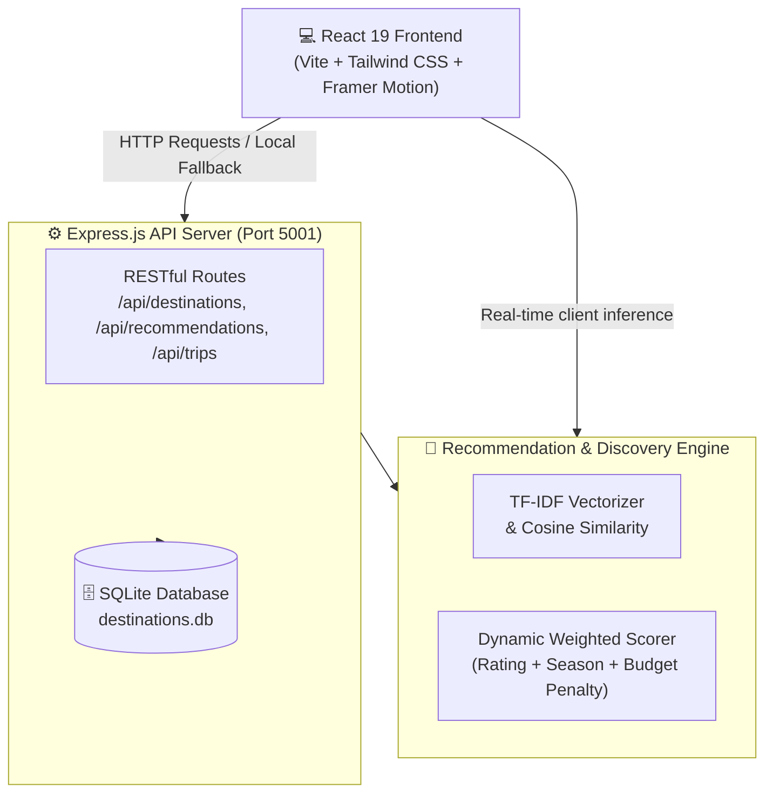

# 🌊 TripMeta — Intelligent Travel & Itinerary Recommendation Engine

<div align="center">

[](https://tripmatee.vercel.app)
[](https://react.dev/)
[](https://www.typescriptlang.org/)
[](https://vitejs.dev/)
[](https://tailwindcss.com/)
[](https://www.sqlite.org/)
[](LICENSE)

<br/>

**A modern, constraint-driven travel platform that computes personalized itineraries using TF-IDF feature vectorization, cosine similarity, and regional ontologies across India.**

[🚀 Explore Live Demo](https://tripmatee.vercel.app) • [📖 Documentation](#system-architecture) • [⚡ Quick Start](#-quick-start) • [✨ Key Features](#-key-features)

</div>

---

## 🌟 Overview

Generic "Top 10" travel listicles often ignore party dynamics, ceiling budgets, seasonal weather, and travel duration constraints. **TripMeta** solves cognitive overload in travel planning by treating itinerary generation as a **multi-dimensional constraint-satisfaction and content-matching problem**.

Built with the fresh, accessible **Ocean Breeze design system**, TripMeta combines a reactive client interface, SQLite database persistence, and an intelligent recommendation engine.

---

## 🎨 Ocean Breeze Design System

TripMeta features a custom-crafted **Ocean Breeze visual palette**, delivering high contrast, accessible typography, and a modern travel-platform aesthetic:

| Color Token | Hex | Preview | Purpose |
|:---|:---:|:---:|:---|
| **Main Background** | `#F8FAFC` |  | Clean, airy global canvas with subtle ambient gradients |
| **Cards & Panels** | `#FFFFFF` |  | White elevated surface cards with soft shadows (`0 2px 10px`) |
| **Primary (Ocean Teal)** | `#0D9488` |  | Action buttons, active nav pills, selected filters, key links |
| **Secondary (Sky Blue)** | `#38BDF8` |  | Timeline highlights, badge accents, interactive hover states |
| **Accent (Fresh Mint)** | `#A7F3D0` |  | Status pills, recommendation affinity tags, subtle accents |
| **Main Text (Deep Navy)** | `#163047` |  | High-contrast headings and prominent typography |
| **Secondary Text (Slate)** | `#64748B` |  | Subtitles, metadata, card descriptions, and labels |
| **Borders & Dividers** | `#E2E8F0` |  | Crisp separators, input outlines, and card borders |

---

## ✨ Key Features

- 🧭 **5-Step Constraint-First Trip Planner**: Input starting hub, party composition (Solo, Couple, Family, Friends), duration, budget ceiling, and travel vibes.
- ⚡ **Affinity Match Scoring Engine**: Real-time evaluation of destinations against multi-attribute vectors (activities, vibes, best months, budget constraints).
- 📅 **Interactive Day-by-Day Itinerary Builder**: Auto-generates structured daily schedules with customizable activities, logistics, timings, and printable PDF export.
- 🗺️ **Comprehensive Destination Atlas**: Deep-dive guides for Indian destinations featuring transit directions, local foods, nearby attractions, and stay recommendations.
- 💾 **SQLite Bookmark & Trip Management**: Save destinations to personal bookmarks and persist custom travel plans locally.
- 📱 **Fully Responsive & Accessible**: Fluid layouts optimized for mobile, tablet, and ultra-wide screens with smooth Framer Motion micro-interactions.

---

## 📐 System Architecture



---

## 🧮 Recommendation Algorithm

TripMeta ranks candidate destinations using a **normalized weighted linear composite score**:

$$\text{FinalScore} = (0.50 \times \text{Similarity}) + (0.30 \times \text{RatingRatio}) + (0.20 \times \text{SeasonalMatch}) - \text{Penalties}$$

### Constraint Penalties
- **Budget Penalty**: If $\text{Budget}_{\text{min}} > \text{UserBudget}_{\text{max}}$, deduct **0.15** points.
- **Duration Penalty**: If $\text{Duration}_{\text{min}} > \text{UserDuration}$, deduct **0.10** points.
- **Score Clamping**: The computed score is mapped to a calibrated match percentage between **18%** and **99%**.

---

## 🛠️ Tech Stack

### Frontend
- **Framework**: [React 19](https://react.dev/) + [Vite 6](https://vitejs.dev/)
- **Routing**: [React Router DOM v7](https://reactrouter.com/)
- **Styling**: [Tailwind CSS 3.4](https://tailwindcss.com/)
- **Icons**: [Lucide React](https://lucide.dev/)
- **Animations**: [Framer Motion](https://www.framer.com/motion/)

### Backend & Storage
- **Runtime**: [Node.js](https://nodejs.org/) (v18+)
- **Server**: [Express 4](https://expressjs.com/) + TypeScript
- **Database**: [SQLite3](https://www.sqlite.org/)
- **Deployment**: [Vercel](https://vercel.com/) (Frontend SPA with fallback catalog and rewrites)

---

## 🚀 Quick Start

### 1. Clone the Repository

```bash
git clone https://github.com/09920/Tripmate.git
cd Tripmate
```

### 2. Install Dependencies

Install all root, backend, and frontend packages with a single command:

```bash
npm run install:all
```

### 3. Start Development Server

Run both the Vite frontend (`http://localhost:5173`) and Express backend (`http://localhost:5001`) simultaneously:

```bash
npm run dev
```

Open your browser at **`http://localhost:5173`** to preview TripMeta.

---

## 📂 Project Structure

```text
├── backend/
│   ├── src/
│   │   ├── data/             # Destination seed catalog & ontologies
│   │   ├── db/               # SQLite connection & schema initialization
│   │   ├── routes/           # Express API endpoints (/destinations, /trips, etc.)
│   │   ├── services/         # Recommendation engine & TF-IDF calculations
│   │   └── index.ts          # Server entry point
│   ├── package.json
│   └── tsconfig.json
├── frontend/
│   ├── src/
│   │   ├── components/       # Layout, Navigation, Footer, Skeletons
│   │   ├── context/          # Toast & App State Context
│   │   ├── data/             # Standalone fallback catalog
│   │   ├── pages/            # Home, Explore, PlanMyTrip, Results, TripBuilder, Saved, About
│   │   ├── services/         # API client & client-side recommendation engine
│   │   ├── types/            # TypeScript interfaces
│   │   ├── App.tsx
│   │   ├── index.css         # Ocean Breeze design tokens & utility classes
│   │   └── main.tsx
│   ├── tailwind.config.js    # Custom Ocean Breeze color system & shadows
│   ├── vite.config.ts
│   └── package.json
├── vercel.json               # SPA routing & build configuration for Vercel
├── run-dev.js                # Cross-platform concurrent runner
└── package.json              # Workspace scripts
```

---

## 🚢 Deployment

### Deploy to Vercel

This repository is pre-configured with `vercel.json` for seamless Vercel deployment:

1. Import the repository in [Vercel Dashboard](https://vercel.com/new).
2. Configure build settings (automatically detected from `vercel.json`):
   - **Build Command**: `npm run build`
   - **Output Directory**: `frontend/dist`
3. Click **Deploy**.

---

## 📄 License

This project is open-source and available under the [MIT License](LICENSE).

---

<div align="center">
  <sub>Crafted with precision for modern travel discovery by <a href="https://github.com/09920">@09920</a>.</sub>
</div>
